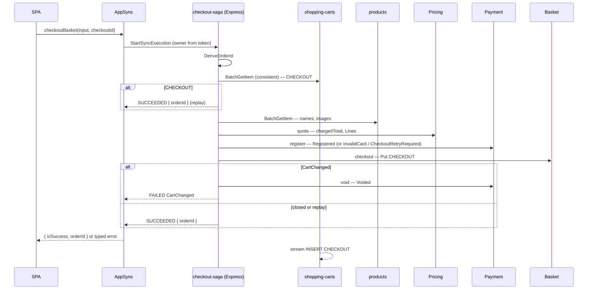

---
tags:
  - status/proposed
  - domain/basket
  - domain/payment
  - domain/pricing
  - domain/catalog
  - domain/appsync
---

# ADR-0050: Checkout as a Step Functions Express Saga

## Status
**Proposed** — October 2026

Amends:

| ADR | What changes | What stands |
|---|---|---|
| [ADR-0048](./0048-points-transactions-ledger-and-in-cart-redemption.md) | §4: the `checkoutBasket` AppSync pipeline is replaced by the `checkout-saga` Express state machine (§1 here); the Pricing read is now orchestrated by Step Functions, not AppSync. §6: the payment row exists before `BasketCheckoutEvent` (status `Registered`); the checkout consumer promotes it to `AwaitingPoints` instead of creating it, and the points-reservation consumer MUST retry while it is still `Registered` (§6 here) | The checkout total is always the server's; a mismatch is rejected, never substituted; Basket passes `PointsToUse` through without reading it; the reservation lifecycle of §5 |
| [ADR-0025](./0025-payment-bounded-context-simulated-gateway-cdc.md) | §3: the `Payment` row is created **at checkout**, synchronously, by `payment-register` (§6 here) | PaymentGateway decides every authorization; the async `PaymentRequestedEvent` hand-off (including its card fields) stays until the order saga replaces it |
| [ADR-0038](./0038-order-drops-card-data-payment-sources-basketcheckout.md) | §1: `OrderId` is derived by the saga, not minted by Basket (§3). §5/§6: `BasketCheckoutEvent` drops the card fields; Payment receives card data once, from the saga, and `PaymentId = OrderId` (§6, §7). §7: `PaymentRequestedRule` also matches `Registered → Pending` | `Order` holds no card data; `OrderId` is the single correlation id across contexts |
| [ADR-0008](./0008-extend-cdc-event-publishing-basket-shoppingcarts-stream-publisher.md) | §2–§4: checkout no longer marks the cart row (`UpdateItem` + MODIFY); it **inserts** a `CHECKOUT#` record and deletes the cart in one transaction, and the publisher fires on that INSERT (§4 here) | Write-before-publish; one publisher Lambda per table; events produced by CDC |
| [ADR-0043](./0043-cart-discount-allocation-policy.md) | Extends §3: the per-line split of the post-campaign price is exposed on the quote (§5 here) | The allocation rule and its home in `CartDiscountAllocation` |
| [ADR-0016](./0016-guest-basket-owner-id-identity-api-key-and-ttl.md) | §1: `shopping-carts`' `OwnerId` gains a third, server-only key namespace, `CHECKOUT#`. §4: `ExpiresAt` is also written on `CHECKOUT#` records (§4 here) | `USER#`/`GUEST#` identity; checkout stays Cognito-only |

Specified by [SPEC-checkout-saga.md](../../SPEC-checkout-saga.md), module 1 of
[SPEC-checkout.md](../../SPEC-checkout.md). Reviewed by `adr-guardian` before acceptance; its
findings are incorporated.

---

## Context

`checkoutBasket` is an AppSync pipeline resolver (ADR-0048 §4): `loadCart` reads the cart, `quote`
asks Pricing for the charged total, `checkout` invokes the Basket Lambda. Reviewing it end to end
found these defects, all confirmed in code:

- **Public, unauthenticated checkout Lambda.** `basket-checkout-basket` had a Function URL with
  `authType: NONE` that no client used. Anyone holding the URL could close any `OwnerId`'s cart with
  any `TotalPrice`, bypassing Pricing. (Removed ahead of this ADR; §2 makes it binding.)
- **Two unconditional writes.** Basket marks the cart row (`UpdateItem`) and then deletes it
  (`DeleteItem`). A crash between them publishes the event and keeps the cart; the retry mints a
  second order.
- **No idempotency key.** `OrderId` is `Guid.NewGuid()` inside the handler. A double click or a
  concurrent retry creates two orders, two payments and two points reservations.
- **Card data where it doesn't belong.** Card number and CVV travel on `BasketCheckoutEvent`
  (EventBridge) and are stored in Basket's `CheckoutData`.
- **Card never validated.** `payment-basket-checkout-consumer` calls `CreatePaymentHandler.CreateNewPayment`
  directly, so `CreatePaymentCommandValidator` (Luhn) never runs. A bad card becomes an order, and the
  decline only arrives later.
- **Quote/close window.** Basket re-reads the cart after Pricing quoted it, so the charged total can
  belong to one cart and the order lines to another.
- **Client-supplied line data.** `storeBasket` stores whatever price, name and image the SPA sends,
  and Basket copies them into the event.
- **No compensation.** APPSYNC_JS has no try/catch across pipeline steps, so a step that writes
  cannot be rolled back when a later one fails.

[ADR-0032](./0032-create-product-with-price-step-functions-express-saga.md) already established the
pattern for a synchronous, multi-context write behind AppSync: an Express state machine started with
`StartSyncExecution` through an HTTP data source, with explicit compensation.

---

## Decision

### 1. `checkoutBasket` runs the `checkout-saga` Express state machine

`checkoutBasket` resolves through the AppSync HTTP data source → `states:StartSyncExecution` →
`checkout-saga` (Express, synchronous), as `createProductWithPrice` does (ADR-0032 §1/§2/§5). The
resolver derives the owner from the Cognito token and passes the client input through. Classification
under [ADR-0009](./0009-appsync-resolver-selection-direct-first-lambda-for-complex-logic.md):
criterion 2 (multi-service orchestration), now with compensation.

Deviations from ADR-0032, deliberate: the state machine uses the **JSONata** query language (needed by
§3's hashing; ADR-0032 §4's numbers-as-strings rule applies only where a DynamoDB task writes N values),
and its execution timeout is **20 s** (below AppSync's 30 s). **Timeout budget (binding):** on the
slowest path, the sum over every state of `TimeoutSeconds × (1 + MaxAttempts)` plus all retry backoff —
including `VoidPayment`'s retries — MUST stay under the execution timeout, so every failure lands in a
`Catch` and a compensation is never cut off. An execution-level `TIMED_OUT` (which no `Catch` sees) is
mapped to `InternalError` by the resolver. It lives in `infra/constructs/checkout-saga.ts`, instantiated by `AppSyncStack` next
to `product-create-saga`.

| State | Kind | Responsibility |
|---|---|---|
| `DeriveOrderId` | Pass (JSONata) | `OrderId` from `(ownerId, checkoutId)` — §3 |
| `LoadCart` | DynamoDB `BatchGetItem` (consistent) of the cart **and** `CHECKOUT#<ownerId>#<checkoutId>` | An existing `CHECKOUT#` record → **replay** (return its `OrderId`), checked **before** anything else; else an empty or missing cart → `BadRequest`; else `ProductId`, `Quantity`, `Version` |
| `CatalogLines` | DynamoDB `BatchGetItem` on `products` | `Name` and main image per line; a missing product → `ProductUnavailable` |
| `Quote` | Lambda `pricing-get-basket-installment-plan` | Charged total and per-line unit price (§5); `Rejection` → `PriceChanged` / `PointsAboveCap`. Retried on transient errors |
| `RegisterPayment` | Lambda `payment-register` | Validates the card, writes the payment `Registered` — §6 |
| `Checkout` | Lambda `basket-checkout-basket` | Atomic, idempotent cart close — §4. **Retried** on transient errors and timeouts (it is idempotent per `checkoutId`) |
| `VoidPayment` | Lambda `payment-void` (compensation) | Runs **only** on a typed refusal from `Checkout` (`CartChanged`): `Registered → Voided`, then fails with that refusal |

The state machine sequences, maps and compensates; it MAY make structural decisions on step output
(presence of a record, an empty item list, a missing product, a refusal type). Every business rule —
prices, card validity, idempotency, versioning — MUST stay in the owning Lambda.

**Ambiguous failures never compensate.** An error from `Checkout` that is not a typed refusal (a
timeout, a service exception) after retries is exhausted may have happened *after* the transaction
committed. The saga then fails with `InternalError` and does **not** void the payment: if the cart was
closed, the event promotes the `Registered` payment normally; if it was not, the `Registered` payment is
an inert orphan (§6).

### 2. The checkout path MUST only be reachable through the saga

No checkout-path Lambda (`basket-checkout-basket`, `payment-register`, `payment-void`) MAY have a
Function URL or any entry point other than the `checkout-saga` (and the local `local.ts` emulation).

### 3. Idempotency key: `checkoutId`; `OrderId` is derived from it

`CheckoutInput` gains `checkoutId`. The SPA mints it when the checkout screen opens and keeps it across
retries of the same attempt. It renews it **only** after a success or a **typed refusal** (§8, every
`errorType` except `InternalError`). An `InternalError`, a client timeout or a network error keeps the
same `checkoutId`: the cart may already be closed (§1), and a retry with the same id hits the replay
check and returns the existing `orderId` instead of failing on a cart that no longer exists.

```
OrderId = GUID( first 32 hex chars of SHA-256( "<ownerId>#<checkoutId>" ) )   formatted 8-4-4-4-12, lowercase
```

The owner is part of the input, so a client-chosen `checkoutId` can never collide with another
customer's order. Two executions of the same attempt derive the same `OrderId`, which is what lets later
steps deduplicate on their own. Test vectors (binding for every implementation; pinned by tests in the
saga and in `local.ts`):

| `ownerId` | `checkoutId` | `OrderId` |
|---|---|---|
| `USER#3f1c2a9e-0b7d-4c55-9a51-2e6f0d8b7c41` | `7d0f5c3e-1a2b-4c3d-8e9f-0a1b2c3d4e5f` | `e9850bd4-ebf5-242c-bbc9-983db36d437a` |
| `USER#3f1c2a9e-0b7d-4c55-9a51-2e6f0d8b7c41` | `11111111-2222-4333-8444-555555555555` | `380fc694-11be-8fed-9b71-c8cd6859df73` |
| `USER#a0b1c2d3-e4f5-4a6b-8c7d-9e0f1a2b3c4d` | `7d0f5c3e-1a2b-4c3d-8e9f-0a1b2c3d4e5f` | `12fda24d-fa69-3cc3-a8f1-688b94844ce3` |

**End state:** `checkoutId: ID!`, and Basket MUST NOT mint `OrderId`. **Transition:** while the SPA and
the schema roll out, `checkoutId` is optional; without it the saga uses `$uuid()` as the `checkoutId`
(no replay protection), and Basket still accepts the old request shape from the old pipeline. Both
end when the saga is live; the MUSTs of this section bind from then on.

### 4. The cart closes in one conditional transaction

The cart gains a `Version` attribute, a new random token on every write (`storeBasket`, `MergeAsync`).
`LoadCart` reads it, and `Checkout` closes the cart with a single `TransactWriteItems`:

```text
Put    OwnerId = CHECKOUT#<ownerId>#<checkoutId>   Type = Checkout, CheckoutData, OrderId, ExpiresAt = now + 24h
       Condition: attribute_not_exists(OwnerId)
Delete OwnerId = <ownerId>
       Condition: Version = :quotedVersion                                   (LoadCart read a Version)
              or: attribute_exists(OwnerId) AND attribute_not_exists(Version) (LoadCart read none — a pre-ADR cart)
```

Both Delete conditions are false when the cart no longer exists, so two attempts with **different**
`checkoutId`s can never both close the same cart. On `TransactionCanceledException`, a failed Put
condition takes precedence (replay: return the stored `OrderId`); a failed Delete condition alone is
`CartChanged`.

`CheckoutedRule` publishes `BasketCheckoutEvent` on the **INSERT** of a `Type = Checkout` record.
Basket builds the event from the request — the lines assembled by the saga — and never re-reads the
cart. `CHECKOUT#` keys are server-only: every resolver that takes an `ownerId` accepts only `USER#`
from the token or a `GUEST#`-prefixed value (ADR-0016, ADR-0041), so no client path can address them.

### 5. Order lines come from their owners, not from the client

Only `ProductId` and `Quantity` are taken from the stored cart. Name and main image come from
Catalog's `products` table. The unit price comes from Pricing: `GetBasketInstallmentPlanResponse.Lines`
exposes, per line, `CartDiscountAllocation`'s share of the **post-campaign card price**, **before** the
points discount, divided by the quantity and rounded to the cent. Because every unit of a line carries
the same price, Σ(`UnitPrice` × `Quantity`) can differ from the post-campaign price by that rounding
(at most half a cent per unit); the order's authoritative amount is the charged total, never the sum
of its lines. This extends ADR-0043 §3 by exposing the per-line split it already computes; the
allocation itself stays in `CartDiscountAllocation`. No points-derived currency
enters Basket's contract (ADR-0046 §1). Name, image and price are a snapshot at checkout time.

### 6. Payment is registered at checkout

`payment-register` validates the card for card payment methods (Luhn, a non-expired `MM/YYYY`, a 3–4
digit CVV; cash needs none) and writes the payment with a **new status `Registered`**, keyed by
`PaymentId = OrderId`, conditioned on `attribute_not_exists`. An invalid card is a typed refusal
(`InvalidCard`), not a Lambda error.

A repeated registration for the same `OrderId` succeeds **only** if the stored payment is still
`Registered` with the same amount, method and installments. Anything else — `Voided`, already
promoted or decided, or different terms (a `checkoutId` reused after its `CHECKOUT#` record expired) —
is the typed refusal `CheckoutRetryRequired`, and the SPA renews the `checkoutId`.

`Registered` MUST NOT trigger the gateway. `PaymentRequestedRule` matches `Registered → Pending` and
the existing `AwaitingPoints → Pending`, and keeps matching INSERT `Pending` while the legacy create
path exists (§3 transition). `payment-void` moves `Registered → Voided` and is a no-op otherwise.

`payment-basket-checkout-consumer` stops creating payments: it promotes the order's `Registered`
payment to `Pending`, or to `AwaitingPoints` when `PointsToUse > 0`. The points-reservation consumers
MUST treat a payment still in `Registered` as not ready and **throw** (EventBridge retry, then DLQ),
exactly as they already do for a missing payment — otherwise a `PointsReservedEvent` that arrives
before the promotion is silently dropped and the payment waits in `AwaitingPoints` forever.

### 7. Card data leaves the event and Basket, and stays out of logs

`BasketCheckoutEvent`/`BasketCheckoutDto` drop `CardName`, `CardNumber`, `Expiration` and `Cvv`;
`PaymentMethod` and `Installments` stay. Card data MUST NOT be on `BasketCheckoutEvent`, MUST NOT be
stored by Basket or Ordering, and MUST NOT be written to any log:

- `checkout-saga` logs at `ERROR` with `includeExecutionData: false`, and its output carries no card
  field. The card does pass through the Express input (and the `StartSyncExecution` response echoes
  it to the resolver, which discards it); Express keeps no execution history.
- AppSync field logging stays at `ERROR` with `excludeVerboseContent: true` (`appsync-api.ts`).
- Any request record that carries card fields MUST redact them in `ToString` (it would otherwise be
  logged whole by the MediatR `LoggingBehavior`).

`PaymentRequestedEvent` still carries card fields to the gateway (ADR-0025 §3) until the order saga
replaces that hand-off; that is the one remaining exception, recorded here so it is not forgotten.

### 8. Error contract

A failed execution's `error` becomes the GraphQL `errorType`; its `cause` (a JSON string) becomes
`errorInfo`. The SPA branches on `errorType` only. Any error outside this table — including an
unhandled Lambda exception — is mapped to `InternalError` with **no** `cause` passed through, so stack
traces never reach the client.

| `errorType` | Raised by | `errorInfo` |
|---|---|---|
| `BadRequest` | `LoadCart` (empty or missing cart) | — |
| `ProductUnavailable` | `CatalogLines` | `{ productIds }` |
| `PriceChanged` | `Quote` | `{ serverTotal, maxRedeemablePoints }` (as today) |
| `PointsAboveCap` | `Quote` | `{ serverTotal, maxRedeemablePoints }` (as today) |
| `InvalidCard` | `RegisterPayment` | `{ field }` |
| `CheckoutRetryRequired` | `RegisterPayment` | — |
| `CartChanged` | `Checkout` | — |
| `CompensationFailed` | `VoidPayment` retries exhausted | — |
| `InternalError` | anything else, including an execution `TIMED_OUT` | — |

`CompensationFailed` and `InternalError` are alarmed on the shared `duckstore-alerts` topic (ADR-0015,
ADR-0022): from a metric filter on the saga's error log if, with `includeExecutionData: false`, the
failure entry still carries the `error` name; otherwise from the Express `ExecutionsFailed` metric.

### 9. Local development

There is no Step Functions locally. `local.ts` emulates the saga step by step against DynamoDB Local
and the Aspire Lambda emulator, using the same `OrderId` formula (checked against §3's vectors) and
raising the same `errorType`s — the same arrangement ADR-0032 §6 uses for `createProductWithPrice`.

### Flow



---

## Consequences

### Positive

- A retried or concurrent attempt resolves to one order, one payment and one event; two different
  attempts can never close the same cart twice.
- The order closes exactly the cart Pricing quoted; a cart changed in between is refused.
- No order data is client-supplied beyond product and quantity.
- Card data is validated on screen and no longer published on `BasketCheckoutEvent` or stored by Basket.
- The checkout path has no public entry point.
- Steps that write have explicit compensation, and the flow is one inspectable definition with X-Ray
  traces, instead of four untested JS files.

### Negative / Costs

- One more synchronous hop (Step Functions) plus one more Lambda (`payment-register`) on the checkout's
  critical path.
- `StartSyncExecution` is at-most-once: a client timeout does not tell whether the checkout happened.
- Two shape changes (event without card, INSERT-based publishing) touch every consumer of
  `BasketCheckoutEvent`.
- An execution aborted between `RegisterPayment` and `Checkout`, or an ambiguous `Checkout` failure
  that did not commit, leaves a `Registered` payment behind.
- `local.ts` carries a second implementation of the sequence.
- `PaymentRequestedEvent` keeps carrying card fields until the order saga.

### Mitigation Strategies

- Latency is measured against a pre-change baseline on dev; Express with optimized `lambda:invoke`
  keeps the overhead small.
- The client retries with the same `checkoutId` and gets the same `orderId`; a retry that can no longer
  be honored is refused with `CheckoutRetryRequired` instead of producing a broken order.
- The shape changes ship tolerant first and the old shapes are removed only after the saga is live (§3).
- A `Registered` payment never reaches the gateway, so an orphan is inert.
- §3's test vectors pin `local.ts` to the same formula.

### Future Constraints

- New pre-order validations (stock, freight quote) MUST be added as states of `checkout-saga`, each
  writing step paired with a compensation that runs only on typed refusals, and MUST report failures
  through §8's contract.
- Any new checkout-path Lambda MUST be invoked only by the saga (§2).
- Orphan `Registered` payments MUST be swept (voided) before any feature reads payments by status.
  The order saga ([SPEC-order-saga.md](../../SPEC-order-saga.md)) plans that reconciler.
- The points reservation moves into this saga next
  ([SPEC-checkout-points-reservation.md](../../SPEC-checkout-points-reservation.md)), and the
  post-checkout choreography is replaced by an order saga
  ([SPEC-order-saga.md](../../SPEC-order-saga.md)); both get their own ADR changes.

---

## Applies To

- `infra/constructs/checkout-saga.ts` (new), `infra/stacks/appsync-stack.ts`, `infra/constructs/appsync-api.ts`
- `infra/constructs/basket-lambdas.ts`, `infra/stacks/basket-stack.ts`, `infra/constructs/payment-lambdas.ts`
- `graphql/schema.graphql`, `graphql/resolvers/basket/mutations/Mutation.checkoutBasket.js`, `Mutation.storeBasket.js`
- `src/Services/Basket/Basket.Function` (checkout, repository, `CheckoutedRule`)
- `src/Services/Payment/Payment.Function` (`RegisterPayment`, `VoidPayment`, status, checkout and points-reservation consumers, `PaymentRequestedRule`)
- `src/Services/Pricing/Pricing.Function` (`GetBasketInstallmentPlan`)
- `src/BuildingBlocks/BuildingBlocks.Messaging/Events/BasketCheckoutEvent.cs`
- `src/WebApps/Shopping.Web.SPA.React` (`features/checkout`, `app/api/graphql/local.ts`)

## References

- [ADR-0032: Product Creation With Price as a Step Functions Express Saga](./0032-create-product-with-price-step-functions-express-saga.md) — the pattern this follows
- [ADR-0048: Points Transactions Ledger and In-Cart Points Redemption](./0048-points-transactions-ledger-and-in-cart-redemption.md) — §4/§6 amended
- [ADR-0025: Payment Bounded Context — Simulated Gateway via Async EventBridge/CDC](./0025-payment-bounded-context-simulated-gateway-cdc.md) — §3 amended
- [ADR-0038: Order Stops Persisting Card Data](./0038-order-drops-card-data-payment-sources-basketcheckout.md) — §1/§5–§7 amended
- [ADR-0008: Basket ShoppingCarts Stream Publisher](./0008-extend-cdc-event-publishing-basket-shoppingcarts-stream-publisher.md) — §2–§4 amended
- [ADR-0016: Guest Basket Owner Id](./0016-guest-basket-owner-id-identity-api-key-and-ttl.md) — §1/§4 amended
- [ADR-0041: BFF Opaque Server-Side Session](./0041-bff-opaque-server-side-session-centralized-cognito-refresh.md) — owner resolution
- [ADR-0043: Cart Discount Allocation Policy](./0043-cart-discount-allocation-policy.md) — the per-line price
- [ADR-0046: Challenge Points Redeem into a Pricing Customer Discount](./0046-challenge-points-redeem-into-pricing-customer-discount.md) — §1, no currency to Challenges
- [ADR-0009: AppSync Resolver Selection](./0009-appsync-resolver-selection-direct-first-lambda-for-complex-logic.md)
- [ADR-0023: Decommission the YARP Gateway — AppSync Is the Only Client Entry Point](./0023-decommission-yarp-gateway-and-angular-spa.md)
- [ADR-0028: Gateway Cost Table](./0028-gateway-cost-table-and-payment-highlights.md) — the card price base
- [ADR-0005: Removal of In-Process Domain Events](./0005-remove-domain-events-cdc-via-dynamodb-streams.md) — the event is still produced by CDC
- [ADR-0015](./0015-sqs-dlq-for-cdc-publishers-and-eventbridge-consumers.md), [ADR-0022](./0022-lambda-production-observability.md) — alarms and logging
