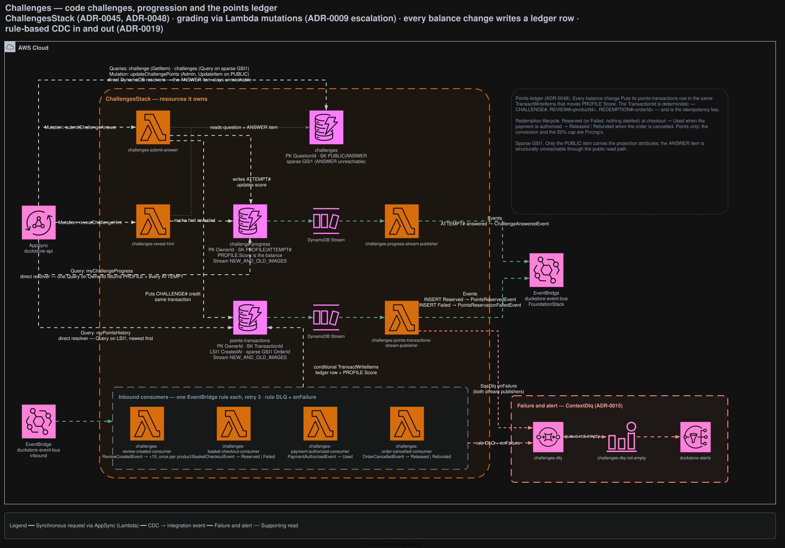

# Challenges

Server-side grading, progression and the points ledger. Grading and every balance change run in
Lambda because they need transactions and domain invariants; everything read-only resolves directly.
Challenges counts points and never sees money: what a point is worth is Pricing's alone.

## Architecture



<sub>Source: [`docs/duckstore-process-flow.drawio`](../../../docs/duckstore-process-flow.drawio), page **Challenges**. Regenerate with `./scripts/export-diagrams.sh`.</sub>

## Responsibilities

- **Questions** — the question bank and the answer key.
- **Progress** — per-player attempts, the score (the points balance) and the points ledger.

**Points move only with a ledger row.** Every balance change writes its `points-transactions` row in
the same `TransactWriteItems` that moves `PROFILE` `Score`, and the deterministic `TransactionId` is
the idempotency key — a redelivered event can never credit or debit twice
([ADR-0048](../../../docs/adr/0048-points-transactions-ledger-and-in-cart-redemption.md)).

| Source | `TransactionId` | Points |
|---|---|---|
| A correct answer | `CHALLENGE#<questionId>` | `+` the question's points |
| A first published review of a bought product | `REVIEW#<productId>` | `+15`, once per product, ever |
| A checkout that used points | `REDEMPTION#<orderId>` | `−` the points used |

**Redemption lifecycle.** A checkout's points are reserved off `BasketCheckoutEvent`
(`Reserved`, or `Failed` with nothing debited when the balance is short), become `Used` when the
payment is authorized, and come back when the order is cancelled (`Released` before payment,
`Refunded` after). The currency conversion and the 20% cap are applied by Pricing before checkout;
Challenges never checks either.

**What it does not do.** No expiry — points never expire. No currency field anywhere, ever
([ADR-0046 §1](../../../docs/adr/0046-challenge-points-redeem-into-pricing-customer-discount.md)).

## Data

| Table | Key | Stream | Notes |
|---|---|---|---|
| `challenges` | PK `QuestionId`, SK `PUBLIC` \| `ANSWER` | — | Sparse GSI1 |
| `challenge-progress` | PK `OwnerId`, SK `PROFILE` \| `ATTEMPT#` | `NEW_AND_OLD_IMAGES` | `PROFILE.Score` is the balance |
| `points-transactions` | PK `OwnerId`, SK `TransactionId` | `NEW_AND_OLD_IMAGES` | LSI1 by `CreatedAt` (history); sparse GSI1 by `OrderId` (operational lookup) |

### The sparse GSI1 is a security boundary

Only the `PUBLIC` item carries the GSI1 projection attributes. The `ANSWER` item (the answer key) is
therefore **structurally unreachable** through the public read path — not merely filtered out
([ADR-0045](../../../docs/adr/0045-challenges-bounded-context-server-side-grading.md)).

## API surface (AppSync)

| Field | Resolver |
|---|---|
| `Query.challenge` | Direct DynamoDB (`GetItem`) |
| `Query.challenges` | Direct DynamoDB (`Query` on the sparse GSI1) |
| `Query.myChallengeProgress` | Direct DynamoDB — one `Query` on `OwnerId` returns `PROFILE` and every `ATTEMPT` in a single round trip |
| `Query.myPointsHistory` | Direct DynamoDB — `Query` on LSI1, newest first, paginated |
| `Mutation.submitChallengeAnswer` | Lambda — `challenges-submit-answer` |
| `Mutation.revealChallengeHint` | Lambda — `challenges-reveal-hint` |
| `Mutation.updateChallengePoints` | Direct DynamoDB — Admin only; edits the `PUBLIC` item, so it applies to future answers only |

The two Lambda mutations are an [ADR-0009](../../../docs/adr/0009-appsync-resolver-selection-direct-first-lambda-for-complex-logic.md)
escalation: grading transactions and domain invariants cannot be expressed in a direct resolver.

`OwnerId` always comes from the token — guests may play but never score.

`Query.myChallengeProgress` is deliberately unpaginated, and that is its ceiling: a direct resolver
cannot follow `LastEvaluatedKey`, so a player whose partition outgrows 1 MB would truncate.

## Integration events

**Publishes** — two rule-based CDC publishers
([ADR-0019](../../../docs/adr/0019-module-oriented-service-structure-and-rule-based-stream-publishers.md)):

- `challenges-progress-stream-publisher`, off `challenge-progress`: `ATTEMPT#` answered → `ChallengeAnsweredEvent`
- `challenges-points-transactions-stream-publisher`, off `points-transactions`: INSERT `Reserved` →
  `PointsReservedEvent`, INSERT `Failed` → `PointsReservationFailedEvent` (consumed by Payment)

**Consumes** — one EventBridge rule per event:

| Lambda | Event | Effect |
|---|---|---|
| `challenges-review-created-consumer` | `ReviewCreatedEvent` | Credits 15 points, once per product |
| `challenges-basket-checkout-consumer` | `BasketCheckoutEvent` | Reserves the checkout's points (only when `PointsToUse > 0`) |
| `challenges-payment-authorized-consumer` | `PaymentAuthorizedEvent` | `Reserved` → `Used` |
| `challenges-order-cancelled-consumer` | `OrderCancelledEvent` | `Reserved` → `Released`, `Used` → `Refunded`, points back |

The two settlement consumers read `REDEMPTION#<orderId>` by key with a consistent read: they receive
every order, and a missing row just means the order used no points, so it is a no-op.

## Failure handling

`challenges-dlq` receives both publishers' `SqsDlq` and every consumer's rule DLQ and async
`onFailure`. Non-empty → `challenges-dlq-not-empty` → `duckstore-alerts`
([ADR-0015](../../../docs/adr/0015-sqs-dlq-for-cdc-publishers-and-eventbridge-consumers.md)).

## Local development

```bash
dotnet run --project src/AppHost/AppHost.csproj
dotnet test tests/Services/Challenges/Challenges.UnitTests/Challenges.UnitTests.csproj
```

Locally EventBridge is best-effort, so the SPA's local GraphQL handler (`local.ts`) simulates the
review credit and the checkout's reservation synchronously.

## Related ADRs

[ADR-0009](../../../docs/adr/0009-appsync-resolver-selection-direct-first-lambda-for-complex-logic.md) ·
[ADR-0019](../../../docs/adr/0019-module-oriented-service-structure-and-rule-based-stream-publishers.md) ·
[ADR-0045](../../../docs/adr/0045-challenges-bounded-context-server-side-grading.md) ·
[ADR-0046](../../../docs/adr/0046-challenge-points-redeem-into-pricing-customer-discount.md) ·
[ADR-0048](../../../docs/adr/0048-points-transactions-ledger-and-in-cart-redemption.md)
