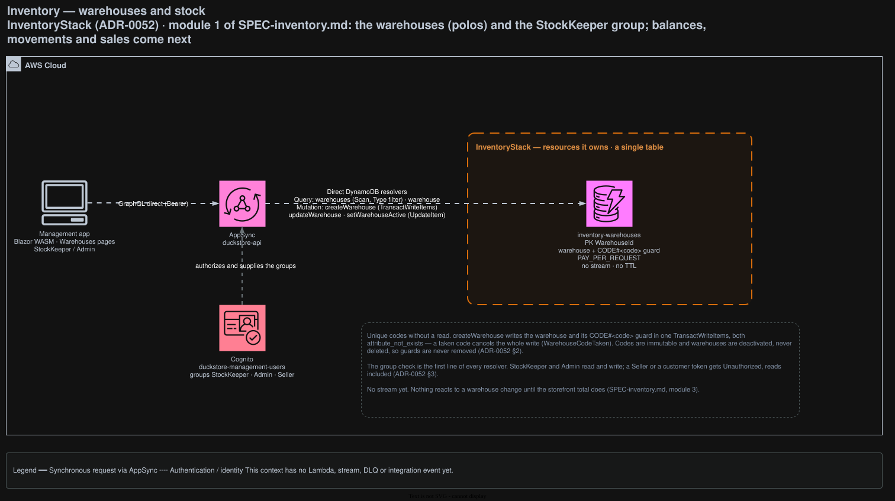

# Inventory

Owns where stock is kept and how much of it there is: the warehouses ("polos"), each product's balance
in each warehouse, and an immutable ledger of every receipt, adjustment and transfer. It is not a field
on the product: the person who receives the goods (the **StockKeeper**) owns the numbers, not the
Seller who lists the product.

## Architecture



<sub>Source: [`docs/duckstore-process-flow.drawio`](../../../docs/duckstore-process-flow.drawio), page **Inventory**. Regenerate with `./scripts/export-diagrams.sh`.</sub>

## Responsibilities

- **Warehouses** — code, name, Brazilian address, priority and active flag
  ([ADR-0052](../../../docs/adr/0052-inventory-bounded-context-warehouses.md) §2).
- **Stock** — the balance of each product × warehouse and the movements ledger (ADR-0052 §7).
- **The storefront's stock** — the total over active warehouses, published to CatalogView (ADR-0052 §8).

**Codes are unique without a read.** `createWarehouse` writes the warehouse and a `CODE#<code>` guard
item in one `TransactWriteItems`, both `attribute_not_exists`, so a taken code cancels the whole
write (`WarehouseCodeTaken`). Codes are uppercase and immutable. Warehouses are deactivated, never
deleted, so balances and history can always point at them and guards are never removed.

**The ledger always adds up.** Every change of a balance writes its ledger row in the same
transaction, so for each product × warehouse the sum of the rows' `quantity` is the stock on hand.
Rows are never edited or deleted: a mistake is corrected with an opposite adjustment. `Available` never
goes negative.

| Movement | Rows | Rules |
|---|---|---|
| Receipt | `Receipt +qty` | Active warehouse only; invoice number required, supplier optional |
| Adjustment | `Adjustment ±qty` | Reason `Count`, `Loss`, `Damage`, `Return` or `Other` (a note is required); an inactive warehouse can only go down |
| Transfer | `TransferOut −qty` + `TransferIn +qty`, one `transferId` | Origin ≠ destination; only the destination must be active, so an inactive warehouse can be emptied |

**A retry never records twice.** Every movement carries an `idempotencyKey` the client mints when the
form opens; the same request with the same key returns the recorded movement, a different request
with it is `IdempotencyKeyReused`. Concurrent movements on one balance are serialised by an
optimistic condition and retried, so each row's `balanceAfter` is exact.

**Priority is the allocation order.** Lower serves a sale first, ties broken by code, and it is the
extension point for a "nearest warehouse" policy. Today it orders the lists.

**The storefront shows Inventory's total.** A product's storefront stock is `Available` summed over its
balances in **active** warehouses, so deactivating a warehouse takes its stock off the storefront at
once. Catalog has no stock field. Totals are ordered by `Version` rather than by time: every balance
write and every `setWarehouseActive` adds one to a counter, and a total's `Version` is the sum of the
counters behind it. So CatalogView keeps the newest total whatever order the events arrive in.

**What it does not do.** No sale reserves stock yet — the direction is in ADR-0052 §6. `Reserved`
exists on every balance and stays 0.
Inventory never reads Catalog's table itself: the product checks and the product names come from
AppSync pipeline steps on Catalog's `products`.

## Data

| Table | Key | Indexes | Stream | Notes |
|---|---|---|---|---|
| `inventory-warehouses` | PK `WarehouseId` | — | `NEW_AND_OLD_IMAGES` | Two item types: `Type = Warehouse` (`<uuid>`, `Version` counts activation changes) and `Type = CodeGuard` (`CODE#<code>`, `TargetWarehouseId`). Every read filters on `Type` |
| `inventory-stock` | PK `ProductId`, SK `WarehouseId` | GSI1 (`WarehouseId`, `ProductId`) | `NEW_AND_OLD_IMAGES` | `Available`, `Reserved`, `WarehouseCode`, `UpdatedAt`, `Version` (counts writes). Written only by `Inventory.Function` |
| `inventory-movements` | PK `ProductId`, SK `MovementId` | LSI1 (`CreatedAt`), GSI1 (`WarehouseId`, `CreatedAt`) | none | The ledger. `MovementId` is the idempotency key (`<key>#OUT`/`#IN` for a transfer). Written only by `Inventory.Function` |

## API surface (AppSync)

Every field checks the group on its first line: **StockKeeper or Admin**, `Unauthorized` for anyone
else, reads included.

| Field | Resolver |
|---|---|
| `warehouses`, `warehouse(id)` | Direct: `Scan` filtered on `Type` (sorted by priority then code), `GetItem` |
| `createWarehouse`, `updateWarehouse`, `setWarehouseActive` | Direct: `TransactWriteItems` (warehouse + guard), `UpdateItem` |
| `stockByProduct(productId)` | Direct `Query`: one row per warehouse and the total |
| `stockByWarehouse(warehouseId, …)` | Direct pipeline: GSI1 of `inventory-stock`, then `BatchGetItem` on `products` for the names |
| `stockMovementsByProduct(productId, …)` | Direct: LSI1 of `inventory-movements`, newest first |
| `stockMovementsByWarehouse(warehouseId, …)` | Direct pipeline: GSI1 of `inventory-movements`, then product names |
| `recordStockReceipt(input)` | Pipeline: `GetItem` on `products` (`ProductNotFound`), then Lambda `inventory-record-stock-receipt` |
| `recordStockAdjustment(input)` | Pipeline: the product check (increases only), then Lambda `inventory-record-stock-adjustment` |
| `transferStock(input)` | Lambda `inventory-transfer-stock` |

The movement Lambdas are an [ADR-0009](../../../docs/adr/0009-appsync-resolver-selection-direct-first-lambda-for-complex-logic.md)
escalation (criterion 1, and 4 for the transfer): they read the warehouse and the balance before the
conditional write. They return expected outcomes as data — `BadRequest` (with `errorInfo.field`),
`WarehouseNotFound`, `WarehouseInactive`, `InsufficientStock` (with `errorInfo.available`),
`IdempotencyKeyReused`, `TransactionConflict` — and anything else surfaces as `InternalError` with no
detail. The rules live in `StockBalance` (`Modules/Stock/Domain`), not in the handlers. Paged fields take
`pageSize` 1–100 (default 20).

The Blazor management app's **Warehouses** and **Stock** pages are the only client.

## Integration events

**Publishes** `ProductStockChangedEvent { ProductId, Available, Version }` (CDC, ADR-0005), through
`StreamRuleDispatcher` (ADR-0019):

| Lambda | Source | Rule |
|---|---|---|
| `inventory-stock-stream-publisher` | `inventory-stock` stream, `INSERT`/`MODIFY` | `ProductStockChangedRule`: the product's total |
| `inventory-warehouses-stream-publisher` | `inventory-warehouses` stream, `MODIFY` of a warehouse whose `Active` changed | `WarehouseActivationRule` (a fan-out rule): one total per product in the warehouse |

Consumed by `catalogview-inventory-sync-consumer` (rule `catalogview-product-stock-changed-rule`).
**Consumes** nothing.

## Failure handling

The movement Lambdas are invoked synchronously by AppSync only (no Function URL), so a failure is
returned to the caller as a GraphQL error. The two stream publishers bisect a failing batch and retry
it 3 times, then send its stream metadata to `inventory-dlq`, whose `inventory-dlq-not-empty` alarm
notifies `duckstore-alerts` (ADR-0015).

## Local development

```bash
dotnet run --project src/AppHost/AppHost.csproj   # seeder: the tables, ALPHA/BETA and the seed products' stock in ALPHA; the Lambdas in the emulator
node scripts/inventory/local-lambda-checks.mjs http://localhost:<emulator-port>   # the Lambdas directly
node scripts/inventory/local-api-checks.mjs       # every field through the SPA's local BFF (local.ts)
node scripts/inventory/evaluate-resolvers.mjs "$PWD"   # resolvers on the real APPSYNC_JS runtime (needs AWS credentials)
dotnet test tests/Services/Inventory/Inventory.UnitTests
cd src/WebApps/Shopping.Web.SPA.React && pnpm test     # lib/warehouse-validation.test.ts, lib/storefront-stock.test.ts
```

EventBridge is best-effort locally, so `local.ts` applies the storefront total to
`catalogview-products` itself, after each movement and after `setWarehouseActive`. The seeder does the
same for the stock it receives into ALPHA. On AWS dev,
`node scripts/inventory/seed-dev-showcase.mjs [--dry-run]` moved the storefront's numbers from Catalog
to Inventory: it recorded one receipt per product into the active `DEV-VITRINE` warehouse.

`local.ts` sends the movements to the real Lambdas through the Aspire Lambda emulator. On macOS the
emulator's generated wrappers only build when the AppHost runs with a non-symlinked `TMPDIR` and
`NoWarn=NU1605` (a pre-existing environment issue, not specific to Inventory):
`TMPDIR=/private/tmp/aspire/ NoWarn=NU1605 dotnet run --project src/AppHost/AppHost.csproj`.

The deployed flow is covered by the Playwright suite `tests/E2E/Inventory/Inventory.E2ETests` (see
[`tests/E2E/README.md`](../../../tests/E2E/README.md)), signed in as a StockKeeper, an Admin and a Seller.

## Related ADRs

- [ADR-0052: Inventory Bounded Context](../../../docs/adr/0052-inventory-bounded-context-warehouses.md)
- [ADR-0009: AppSync Resolver Selection](../../../docs/adr/0009-appsync-resolver-selection-direct-first-lambda-for-complex-logic.md)
- [ADR-0019: Module-Oriented Service Structure and Rule-Based Stream Publishers](../../../docs/adr/0019-module-oriented-service-structure-and-rule-based-stream-publishers.md) — the publishers, including the fan-out rule
- [ADR-0048: Points Transactions Ledger](../../../docs/adr/0048-points-transactions-ledger-and-in-cart-redemption.md) — the ledger precedent
- [ADR-0050: Checkout as a Step Functions Express Saga](../../../docs/adr/0050-checkout-step-functions-express-saga.md) — the idempotency and refusal contracts, and where the stock reservation will live
