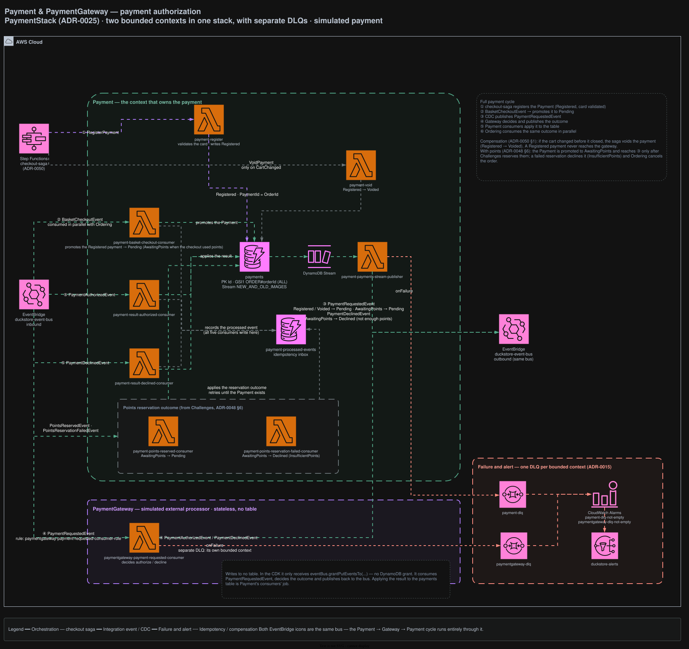

# Payment

Simulates payment authorization for orders. Two bounded contexts share this stack — **Payment**, which
owns the payment record, and **PaymentGateway**, the simulated external processor.

## Architecture



<sub>Source: [`docs/duckstore-process-flow.drawio`](../../../docs/duckstore-process-flow.drawio), page **Payment**. Regenerate with `./scripts/export-diagrams.sh`.</sub>

## Responsibilities

- **Payment** owns `payments`: it registers the payment during the checkout saga (validating the
  card), promotes it when the checkout event arrives, and applies the gateway's outcome. It is the only
  context that ever holds card data
  ([ADR-0050](../../../docs/adr/0050-checkout-step-functions-express-saga.md)).
- **PaymentGateway** ([`../PaymentGateway`](../PaymentGateway)) decides authorize/decline. It is
  stateless: in the CDK it receives only `eventBus.grantPutEventsTo(...)` and **no DynamoDB grant**.

## The full cycle

The two EventBridge icons on the diagram are the same bus — the round trip runs through it.

1. During the checkout, the `checkout-saga` invokes `payment-register`: the card is validated (Luhn,
   expiry, CVV — cash needs none) and the payment is written `Registered`, keyed by
   `PaymentId = OrderId`. An invalid card is refused on the checkout screen (`InvalidCard`). A
   `Registered` payment never reaches the gateway; if the cart changed before it closed, the saga
   invokes `payment-void` (`Registered → Voided`)
2. `BasketCheckoutEvent` → `payment-basket-checkout-consumer` promotes the payment to `Pending`
   (Ordering consumes the same event in parallel)
3. CDC publishes `PaymentRequestedEvent`
4. The gateway decides and publishes `PaymentAuthorizedEvent` / `PaymentDeclinedEvent`
5. Payment's own consumers apply the outcome to the `payments` table
6. Ordering consumes that same outcome independently

A repeated registration for the same order succeeds only while the payment is still `Registered` with
the same amount and card; anything else is refused with `CheckoutRetryRequired`. The promotion also
accepts a `Voided` payment: the checkout event proves the cart closed under that order, so a void that
raced a successful close of the same attempt must not leave the order unpaid.

### When the checkout used points

The payment must not reach the gateway before the points are actually reserved, or it could be
authorized with a discount the customer didn't have
([ADR-0048 §6](../../../docs/adr/0048-points-transactions-ledger-and-in-cart-redemption.md)):

1. A checkout with `PointsToUse > 0` promotes the payment to `AwaitingPoints`, not `Pending` — which
   publishes nothing. Challenges consumes the same `BasketCheckoutEvent` and reserves the points.
2. `PointsReservedEvent` → `payment-points-reserved-consumer` moves it `AwaitingPoints → Pending`;
   `PaymentRequestedRule` matches that MODIFY, and the cycle above continues from step 3.
3. `PointsReservationFailedEvent` → `payment-points-reservation-failed-consumer` declines it
   (`InsufficientPoints`); `PaymentDeclinedInsufficientPointsRule` publishes `PaymentDeclinedEvent`
   so Ordering cancels the order, and Payment's own result consumer ignores it (no longer `Pending`).

Both consumers **throw** while the payment is not yet promoted (still `Registered`) — the two contexts
consume the checkout in parallel, so the reservation can arrive first, and EventBridge retries.

## Data

| Table | Key | Stream | Notes |
|---|---|---|---|
| `payments` | PK `Id`, GSI1 `ORDER#<orderId>` (ALL) | `NEW_AND_OLD_IMAGES` | Drives the CDC publisher; GSI1 finds the payment of an order |
| `payment-processed-events` | PK `PK` | — | Idempotency inbox, written by all five Payment consumers |

## API surface (AppSync)

None directly. `payment-register` and `payment-void` are invoked only by the `checkout-saga` behind
`Mutation.checkoutBasket` (no Function URL, no event source); everything else is reached through
events.

## Integration events

**Consumes**

| Rule | Event |
|---|---|
| `payment-basket-checkout-consumer-rule` | `BasketCheckoutEvent` |
| `payment-result-authorized-consumer-rule` | `PaymentAuthorizedEvent` |
| `payment-result-declined-consumer-rule` | `PaymentDeclinedEvent` |
| `payment-points-reserved-consumer-rule` | `PointsReservedEvent` (Challenges) |
| `payment-points-reservation-failed-consumer-rule` | `PointsReservationFailedEvent` (Challenges) |
| `paymentgateway-payment-requested-consumer-rule` | `PaymentRequestedEvent` |

**Publishes**

- `PaymentRequestedEvent` — via `payment-payments-stream-publisher` (CDC off `payments`), on the
  MODIFY into `Pending` from `Registered`, `Voided` or `AwaitingPoints`
- `PaymentDeclinedEvent` — the same publisher, on MODIFY `AwaitingPoints → Declined` (not enough points)
- `PaymentAuthorizedEvent` · `PaymentDeclinedEvent` — from the gateway consumer

Downstream, `PaymentAuthorizedEvent` is also consumed by Challenges, which marks the order's reserved
points `Used`; it carries `CustomerId` for that.

## Failure handling

**Two DLQs, one per bounded context** — `payment-dlq` and `paymentgateway-dlq`. Keeping them separate
means a gateway failure never hides behind Payment's own backlog. Both alarm into `duckstore-alerts`
([ADR-0015](../../../docs/adr/0015-sqs-dlq-for-cdc-publishers-and-eventbridge-consumers.md)).

## Local development

```bash
dotnet run --project src/AppHost/AppHost.csproj
dotnet test tests/Services/Payment/Payment.UnitTests/Payment.UnitTests.csproj
```

The checkout flow end to end, against a deployed environment, is covered by
[`tests/E2E/Checkout`](../../../tests/E2E/README.md).

## Related ADRs

[ADR-0005](../../../docs/adr/0005-remove-domain-events-cdc-via-dynamodb-streams.md) ·
[ADR-0015](../../../docs/adr/0015-sqs-dlq-for-cdc-publishers-and-eventbridge-consumers.md) ·
[ADR-0025](../../../docs/adr/0025-payment-bounded-context-simulated-gateway-cdc.md) ·
[ADR-0048](../../../docs/adr/0048-points-transactions-ledger-and-in-cart-redemption.md) ·
[ADR-0050](../../../docs/adr/0050-checkout-step-functions-express-saga.md)
