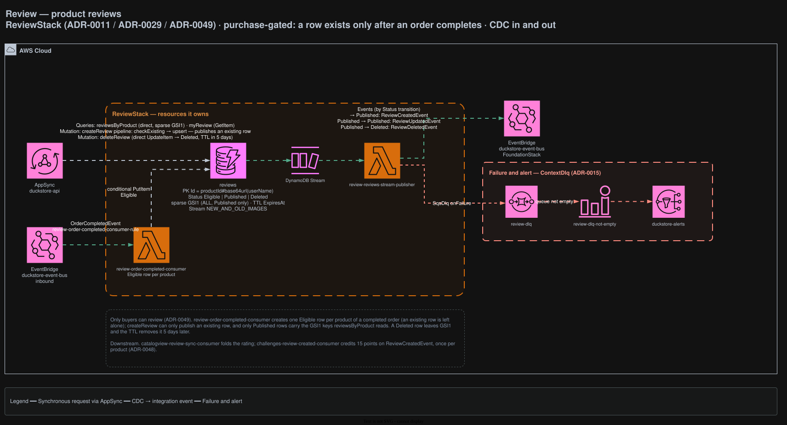

# Review

Owns product reviews and ratings. Only buyers can review: a review row exists only after an order
for that product completes, and `createReview` can only publish an existing row
([ADR-0049](../../../docs/adr/0049-review-status-eligibility-sparse-gsi1-ttl-and-review-deleted.md)).

## Architecture



<sub>Source: [`docs/duckstore-process-flow.drawio`](../../../docs/duckstore-process-flow.drawio), page **Review**. Regenerate with `./scripts/export-diagrams.sh`.</sub>

## Responsibilities

- Owns `reviews`, upserting by composite key with a rating delta
  ([ADR-0029](../../../docs/adr/0029-review-upsert-composite-key-and-rating-delta.md)).
- Publishes review changes; it does **not** compute the average rating, and it does not credit the
  review points — Challenges does that off `ReviewCreatedEvent`, once per product
  ([ADR-0048](../../../docs/adr/0048-points-transactions-ledger-and-in-cart-redemption.md)).

Every row has a `Status`:

| Status | Set by | Visible in `reviewsByProduct` |
|---|---|---|
| `Eligible` | `review-order-completed-consumer`, off `OrderCompletedEvent` | No |
| `Published` | `createReview` (only updates an existing row, so non-buyers cannot review) | Yes — only Published rows carry the sparse GSI1 keys |
| `Deleted` | `deleteReview`; TTL on `ExpiresAt` removes the row 5 days later, and republishing before that cancels it | No |

Rows without `Status` predate ADR-0049 and count as Published.

The average is folded into the read model by `catalogview-review-sync-consumer`. Rating aggregation
also used to live in Catalog — the old `catalog-review-created-consumer` no longer exists
([ADR-0011 §4](../../../docs/adr/0011-review-bounded-context-rating-aggregation-via-cdc.md)), and
`ReviewCreatedEvent` never touches the `products` table.

## Data

| Table | Key | Stream | Notes |
|---|---|---|---|
| `reviews` | PK `productId#base64url(userName)`, sparse GSI1 (ALL) | `NEW_AND_OLD_IMAGES` | One review per user per product, enforced by the key; TTL on `ExpiresAt` (Deleted rows) |

## API surface (AppSync)

| Field | Resolver |
|---|---|
| `Query.reviewsByProduct` | Direct DynamoDB, through the sparse GSI1 (Published only) |
| `Query.myReview` | Direct DynamoDB `GetItem` on the caller's own row — tells the SPA whether to show the form |
| `Mutation.createReview` | Pipeline resolver: `checkExisting` → `upsert` — publishes an Eligible, Published or Deleted row, never creates one |
| `Mutation.deleteReview` | Direct DynamoDB `UpdateItem`: Published → Deleted, out of GSI1, `ExpiresAt` in 5 days |

## Integration events

**Publishes** — `review-reviews-stream-publisher`, off the `reviews` stream:

- `ReviewCreatedEvent` when a row becomes Published (from Eligible, Deleted, or a legacy INSERT)
- `ReviewUpdatedEvent` when a Published row is edited
- `ReviewDeletedEvent` when a Published row becomes Deleted

All three are consumed by `catalogview-review-sync-consumer` and by the SPA's SST `revalidator` (the
`reviews:{id}` tag covers the raw review list, which lives here rather than in `catalogview-products`).
`ReviewCreatedEvent` is also consumed by `challenges-review-created-consumer`, which credits the
review points.

**Consumes** — `review-order-completed-consumer-rule`: `OrderCompletedEvent` → one Eligible row per
product in the order (an existing row is left alone).

## Failure handling

`review-dlq` receives the publisher's `SqsDlq` and the consumer's rule DLQ and async `onFailure`. Non-empty → `review-dlq-not-empty` →
`duckstore-alerts` ([ADR-0015](../../../docs/adr/0015-sqs-dlq-for-cdc-publishers-and-eventbridge-consumers.md)).

## Local development

```bash
dotnet run --project src/AppHost/AppHost.csproj
dotnet test tests/Services/Review/Review.UnitTests/Review.UnitTests.csproj
```

## Related ADRs

[ADR-0011](../../../docs/adr/0011-review-bounded-context-rating-aggregation-via-cdc.md) ·
[ADR-0029](../../../docs/adr/0029-review-upsert-composite-key-and-rating-delta.md) ·
[ADR-0030](../../../docs/adr/0030-catalogview-dynamodb-drop-opensearch.md) ·
[ADR-0040](../../../docs/adr/0040-catalogview-consumers-consolidated-by-producer-strategy-dispatch.md) ·
[ADR-0048](../../../docs/adr/0048-points-transactions-ledger-and-in-cart-redemption.md) ·
[ADR-0049](../../../docs/adr/0049-review-status-eligibility-sparse-gsi1-ttl-and-review-deleted.md)
